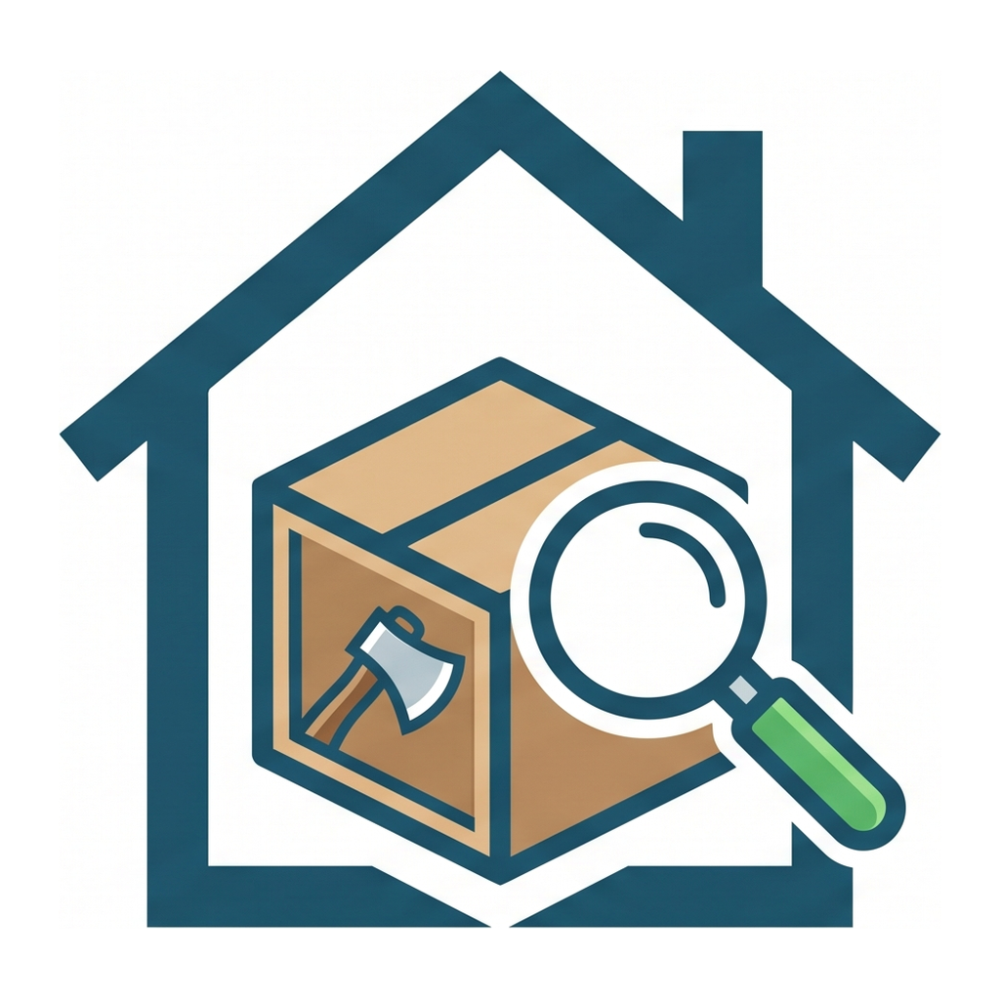
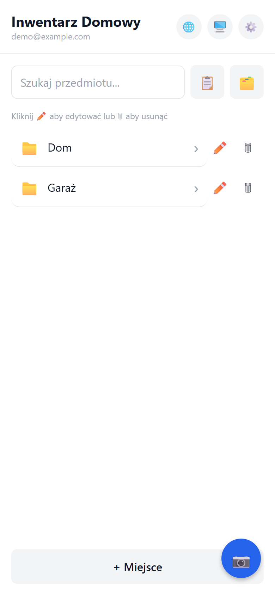
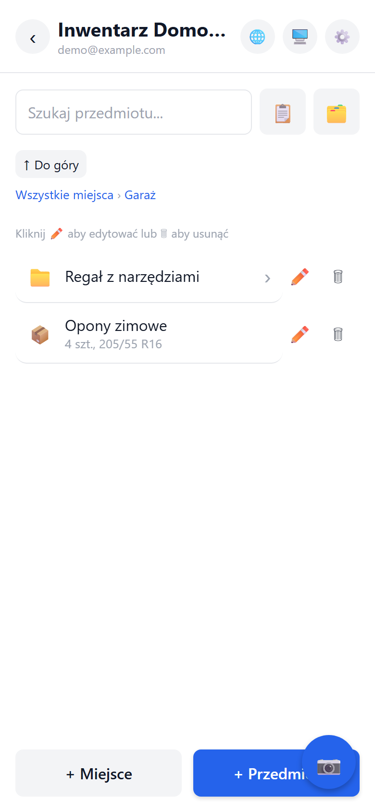
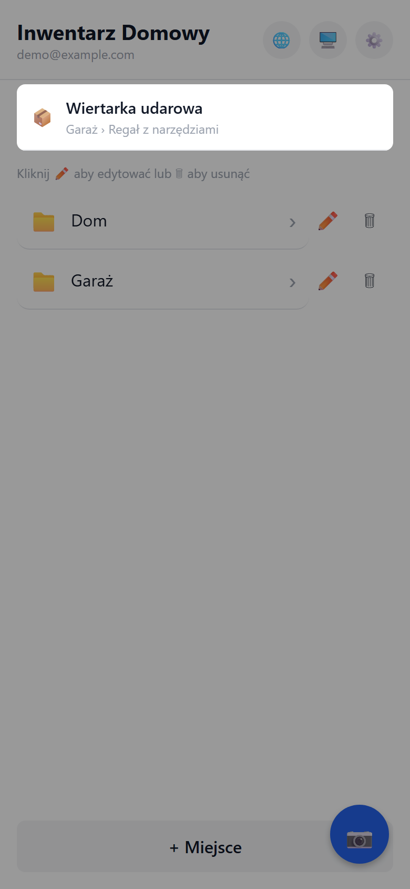
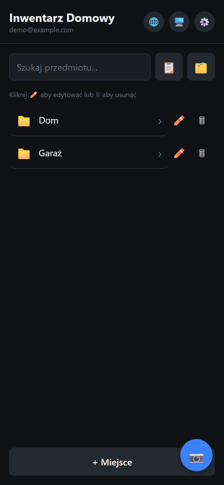
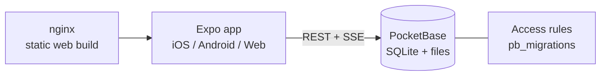

<div align="center">



# Inwentarz Domowy (Home Inventory)

**Know where you keep your things.** Record where every item lives, from a drawer to the garage, and find it in seconds.

[](https://github.com/RG-automations/home-inventory/actions/workflows/ci.yml)
[](LICENSE)


</div>

## What is it?

"Where did I put the drill?" Home Inventory is an app (iOS, Android, web/PWA) where you build a tree of places (house → room → cupboard → box), add items with photos, and search them instantly. The backend is a single PocketBase binary you can self-host.

## Features

- Hierarchical locations of any depth, tree view and breadcrumbs
- Photos of items and places (compressed to 1600 px)
- Fast search across all items, quick add, swipe gestures
- 8 languages: pl, en, de, es, fr, ar (RTL), hi, zh
- Light/dark theme, reduced-motion support
- Per-user data enforced by database access rules; data export (GDPR)
- Self-hosting with Docker + nginx + PocketBase

## Screenshots

Demo data only.

| Places | Inside a place | Search | Dark mode |
|:--:|:--:|:--:|:--:|
|  |  |  |  |

## Architecture



## Prerequisites

- Node.js 20+ and npm
- Docker with Compose (local PocketBase and deployment)
- Optional: Expo Go, Android emulator or Xcode

## Quick start

```bash
git clone https://github.com/RG-automations/home-inventory.git
cd home-inventory
cp .env.example .env                                   # Windows: copy .env.example .env

docker compose -f pocketbase/docker-compose.yml up -d  # PocketBase on http://localhost:8090
# open http://localhost:8090/_/ and create the superuser; migrations in pocketbase/pb_migrations apply automatically

npm ci
npm run web                                            # or: npm run android / npm run ios
```

## Docker deployment

```bash
npx expo export --platform web                         # builds ./dist
docker compose -f deploy/docker-compose.yml up -d --build
# app: http://localhost:8088
```

`EXPO_PUBLIC_POCKETBASE_URL` is compiled into the bundle, so set it **before** building. Put everything behind HTTPS in production.

## Configuration

| Variable | Description | Default |
|---|---|---|
| `EXPO_PUBLIC_POCKETBASE_URL` | PocketBase instance URL | `http://localhost:8090` |

For your own native builds change in `app.json`: `expo.owner`, `expo.extra.eas.projectId`, `ios.bundleIdentifier`, `android.package`.

## Project structure

```
app/          screens (expo-router)
components/   UI components
lib/          PocketBase client, i18n, theme, subscription logic
locales/      translations
pocketbase/   docker-compose + schema and access-rule migrations
deploy/       nginx + Dockerfile for the web build
```

## API example

The backend is the standard PocketBase REST API:

```bash
curl -X POST http://localhost:8090/api/collections/users/auth-with-password \
  -H 'Content-Type: application/json' -d '{"identity":"you@example.com","password":"..."}'
```

## Roadmap

- [x] Location tree, photos, search
- [x] 8 languages, dark mode
- [ ] Barcode/QR labels for boxes
- [ ] Share an inventory with family members
- [ ] CSV import/export
- [ ] Offline mode with sync
- [ ] Automated tests

## Contributing

Pull requests are welcome. Read [CONTRIBUTING.md](CONTRIBUTING.md), open an [issue](https://github.com/RG-automations/home-inventory/issues/new/choose) for bugs and ideas, and report vulnerabilities privately per [SECURITY.md](SECURITY.md).

## License

[AGPL-3.0](LICENSE). If you run a modified version as a network service, you must publish your changes.
